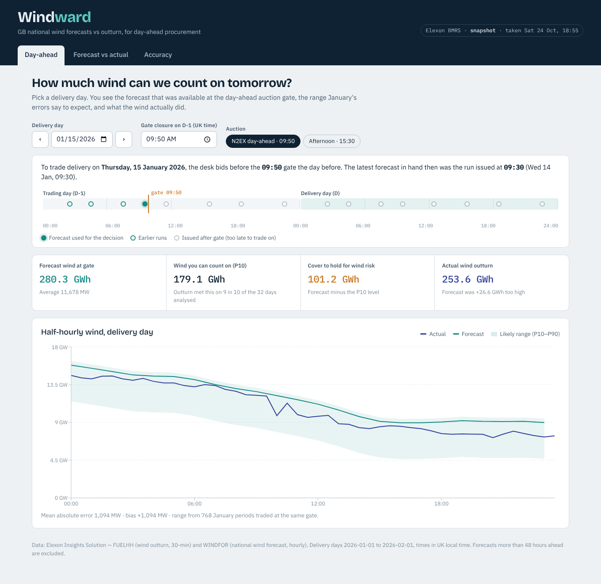

# Windward — day-ahead wind forecast monitor

A web app for a UK utility's day-ahead trading desk. It shows the national wind forecast that was actually available when the desk had to buy power, and measures how accurate those forecasts were, so purchase volumes can be sized with the error in mind.

**Live app:** https://YOUR-PROJECT.vercel.app



## What it does

| View | Question it answers |
| --- | --- |
| **Day-ahead** | For a delivery day, what wind forecast did we have at the auction gate on D-1, how much of it can we rely on (P10), and what actually happened? |
| **Forecast vs actual** | Pick a time range and a forecast horizon (0–48 h). For each half hour, plot actual wind against the latest forecast published at least that many hours earlier. |
| **Accuracy** | How error grows with lead time, the bias, and a day-by-day scorecard for January. |

Key result: in January 2026 the forecast available at the 09:50 gate over-predicted wind on **29 of 32** delivery days, by **+1.8 GW** on average (MAE 2.1 GW). Most of the error is bias rather than noise. See [docs/PROJECT_REPORT.md](docs/PROJECT_REPORT.md) and the [analysis notebook](analysis/forecast_error_analysis.ipynb).

## Data

- **Actuals:** Elexon `FUELHH` stream, `fuelType = WIND`, half-hourly (`startTime`, `generation`).
- **Forecasts:** Elexon `WINDFOR` stream, hourly (`startTime`, `publishTime`, `generation`).
- **Scope:** purchase decisions made in January 2026, i.e. delivery from 1 Jan to 1 Feb 2026. Forecasts with a lead time below 0 h or above 48 h are ignored.

The backend ships with a gzipped snapshot of this window (`backend/data/wind_snapshot.json.gz`, ~110 KB) so the app is fast and works even if Elexon is down. Set `DATA_SOURCE=live` to load from the Elexon API instead (falls back to the snapshot on failure). `python -m scripts.fetch_snapshot` refreshes the snapshot.

## Run it

### Docker (recommended)

```bash
docker compose up --build
```

Open http://localhost:8080. API docs: http://localhost:8000/api/docs

### Without Docker

Requires Python 3.11+ and Node 20+.

```bash
# API
cd backend
python -m venv .venv && source .venv/bin/activate   # Windows: .venv\Scripts\activate
pip install -r requirements-dev.txt
uvicorn app.main:app --reload --port 8000

# Web app (second terminal)
cd frontend
npm install
npm run dev
```

Open http://localhost:5173 (Vite proxies `/api` to port 8000).

### Tests and lint

```bash
cd backend && pytest && ruff check . && ruff format --check .
cd frontend && npm test && npm run build
```

The same checks run in GitHub Actions on every push (`.github/workflows/ci.yml`).

### Deploy (Vercel)

Import the repo in Vercel with default settings; `vercel.json` builds the React app into static files and serves the FastAPI app as a Python function at `/api/*`. No environment variables or database are needed.

## API

| Endpoint | Description |
| --- | --- |
| `GET /api/meta` | Data window, defaults, data source |
| `GET /api/generation?start&end&horizon` | Actual vs forecast series at a minimum lead time, error stats, P10–P90 band, error by hour |
| `GET /api/day-ahead?date&gate` | Forecast at gate closure on D-1 for one delivery day, energy totals, P10/P90 wind, forecast runs |
| `GET /api/accuracy/horizons?start&end&step` | MAE / RMSE / bias / P90 by lead time |
| `GET /api/accuracy/daily?gate` | Daily energy error for every delivery day |

Times are ISO 8601 in UTC; `date` and `gate` are UK local. Interactive docs at `/api/docs`.

## Repository layout

```
.
├── backend/                  FastAPI service (Python)
│   ├── app/
│   │   ├── main.py           App factory, middleware, router registration
│   │   ├── routes.py         HTTP endpoints and input validation
│   │   ├── analytics.py      Builds each view (series, stats, bands, daily energy)
│   │   ├── forecasting.py    Core logic: pick the latest forecast before a cutoff
│   │   ├── metrics.py        Error statistics (MAE, RMSE, bias, percentiles)
│   │   ├── store.py          Loads data (snapshot or live) and caches it in memory
│   │   ├── elexon.py         Elexon API client with chunking, retries, de-duplication
│   │   ├── snapshot.py       Read/write the bundled data snapshot
│   │   ├── schemas.py        Response models (camelCase JSON)
│   │   ├── models.py         Domain records
│   │   └── config.py         Settings from environment variables
│   ├── data/                 Bundled January 2026 snapshot
│   ├── scripts/              fetch_snapshot.py
│   ├── tests/                pytest suite (unit + API)
│   └── Dockerfile
├── frontend/                 React + Vite app
│   ├── src/
│   │   ├── views/            DayAheadView, ExplorerView, AccuracyView
│   │   ├── components/       Charts, decision timeline, stat tiles
│   │   ├── api/client.js     API client
│   │   ├── hooks/useApi.js   Fetch hook with cancellation
│   │   └── lib/format.js     Number and UK-time helpers (+ tests)
│   ├── nginx.conf            Static hosting + /api proxy in Docker
│   └── Dockerfile
├── api/index.py              Vercel entry point for the FastAPI app
├── analysis/                 Jupyter notebook with the forecast error analysis
├── docs/                     Project report and screenshots
├── docker-compose.yml
└── vercel.json
```

## Use of AI tools

AI coding assistants were used while building this project, for parts of the code, tests and documentation. All output was reviewed and verified (unit and API tests, lint, and cross-checking results against the raw Elexon data) before submission.
