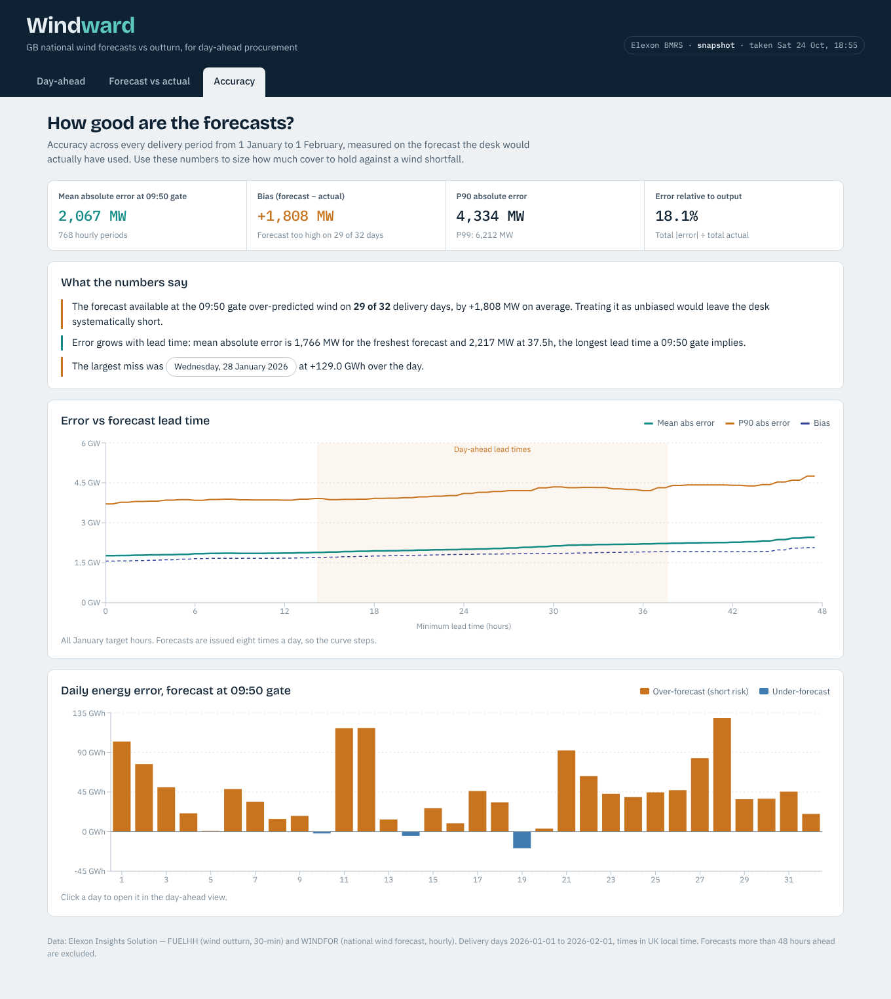

# Project report: day-ahead wind forecast monitor

## 1. Summary

The client's day-ahead desk must buy, one day ahead, whatever demand renewables will not cover. Wind is the largest and most volatile part of that, so the desk depends on the national wind forecast. This pilot delivers a web app that answers two questions for January 2026:

1. **What forecast did we have when we had to decide?** For any delivery day, the app shows the forecast run in hand at the day-ahead gate on D-1, alongside every other run and the actual outturn.
2. **How wrong is it, and in which direction?** The app measures error at every lead time and turns it into a planning number: the wind level that was met or beaten 9 times in 10.

The headline finding: **the forecast the desk trades on over-predicted wind on 29 of 32 delivery days, by +1.8 GW on average.** Most of the error is systematic bias rather than random noise. A simple bias correction, tested out-of-sample, would cut mean absolute error by about 28%.

## 2. Domain context

- **Day-ahead market.** GB power for delivery day D is traded in auctions on D-1. The N2EX GB day-ahead auction closes at 09:50 UK time, so that is the default decision point. The gate is a setting in the app, so other auctions or internal deadlines can be tested.
- **Why wind matters.** Volume to buy ≈ demand − expected renewable output. If wind is over-forecast, the desk under-buys and covers the gap later, usually at a worse price (intraday or imbalance). Bias in the forecast therefore turns directly into cost.
- **Forecast vs decision time.** A forecast is only useful if it was published before the decision. Every number in this app is computed using forecasts with `publishTime ≤ decision time`, never hindsight.

## 3. Data

| Dataset | Content | Resolution | January 2026 coverage |
| --- | --- | --- | --- |
| `FUELHH` (`fuelType = WIND`) | Outturn wind generation, MW | 30 min | 1,536 half hours, none missing |
| `WINDFOR` | National wind forecast, MW | 60 min | 272 runs, 12,256 rows with 0–48 h lead |

- WINDFOR is published eight times a day (02:30, 04:30, 07:30, 09:30, 11:30, 15:30, 18:30, 22:30 UTC, plus one irregular run). Each run covers hourly targets up to about two days ahead.
- **Window.** Decisions made in January 2026 cover delivery from 1 January to 1 February 2026. Forecasts published from 30 December onwards are included so the first days have full 48-hour history.
- **Filtering.** Forecasts with a lead time below 0 h (published after the target) or above 48 h are discarded, as the brief requires.
- **Alignment.** Actuals are half-hourly and forecasts hourly. Error metrics use hourly targets where both exist; daily energy compares mean MW × hours so the two resolutions are treated fairly.
- **Time zone.** The API uses UTC; the UI shows UK time. In January these are the same, but the code handles BST and 23/25-hour clock-change days (unit-tested).

## 4. Product

**Day-ahead view.** The decision view, and the default. A timeline shows D-1 and D, every forecast run, the gate closure, and which run the desk would have used. Four figures follow: forecast wind energy at gate, wind you can count on (P10), cover to hold for wind risk (the gap between the two) and actual outturn. The chart overlays actual, forecast and a P10–P90 band.

**Forecast vs actual view.** This implements the brief directly: choose a start, an end and a horizon (0–48 h). For each target time, the forecast shown is the latest one published at least *horizon* hours before it. Error statistics and error by hour of day update with the selection.

**Accuracy view.** Error against lead time across January, with the day-ahead range highlighted; a daily scorecard of energy error (click a day to open it in the day-ahead view); and plain-language findings generated from the data.



## 5. Method

**Forecast selection.** For target time *t* and decision cutoff *c*, choose the forecast with the latest `publishTime ≤ c`, among forecasts with a 0–48 h lead. Two cutoff rules share one implementation (`forecasting.py`):

- fixed horizon *h*: `c = t − h` (the explorer view)
- gate closure: `c = gate time on D-1, UK local` (the day-ahead view)

Lookups use a per-target sorted list and binary search, so the full month for 49 horizons computes in about 0.2 s.

**Metrics** (`error = forecast − actual`; positive means over-forecast):

| Metric | Why it is there |
| --- | --- |
| MAE | Typical miss in MW; easy to explain |
| RMSE | Penalises large misses, which drive imbalance cost |
| Bias (mean error) | Direction of error; the most actionable number here |
| P50 / P90 / P99 absolute error | Tail risk for sizing cover |
| WAPE | Error relative to total output, comparable across periods |

**Planning band.** Residuals (`actual − forecast`) are pooled across all January periods under the same rule (same horizon or same gate). The band is `forecast + P10 residual` to `forecast + P90 residual`. For the day as a whole, the P10 of *daily energy* residuals across the 32 days gives "wind you can count on". Daily errors are correlated within a day, so summing hourly P10s would overstate risk; using daily residuals avoids that.

## 6. Results

### Error by lead time (all January target hours)

| Minimum lead time | MAE (MW) | Bias (MW) | P90 abs error (MW) |
| --- | --- | --- | --- |
| 0 h | 1,766 | +1,564 | 3,708 |
| 12 h | 1,864 | +1,674 | 3,851 |
| 24 h | 2,005 | +1,815 | 4,101 |
| 36 h | 2,205 | +1,906 | 4,208 |
| 46 h | 2,422 | +2,049 | 4,596 |

### At the 09:50 gate (what the desk trades on)

| MAE | RMSE | Bias | P90 abs error | P99 abs error | WAPE | Hours over-forecast |
| --- | --- | --- | --- | --- | --- | --- |
| 2,067 MW | 2,575 MW | +1,808 MW | 4,334 MW | 6,212 MW | 18.1% | 84.8% |

- Over-forecast on **29 of 32** days; mean daily error **+43.4 GWh**; worst day **28 January, +129.0 GWh**.
- **A later gate helps a little:** MAE 2,067 MW at 09:50, 1,958 MW at 12:00 and 1,933 MW at 15:30 (about 6% better). The bias barely changes.
- **Error grows with wind level:** forecasts above 20 GW missed by 4.6 GW on average, all in the over-forecast direction; below 5 GW the bias is about +0.2 GW.
- **Bias correction:** subtracting the mean error of the *other* days (leave-one-day-out) reduces MAE from 2,067 to 1,478 MW (−28.5%) and P90 absolute error from 4,334 to 3,105 MW.
- **Reliable wind:** at the gate, actual wind came in above `forecast − 4.3 GW` in 9 of 10 hours, and above `forecast − 101 GWh` on 9 of 10 days. Without any forecast, January wind exceeded 5.4 GW 90% of the time.

**Worked example, 15 January.** The 09:30 run on 14 January forecast 280.3 GWh. The P10 level was 179.1 GWh, so the desk should hold about 101 GWh of cover against shortfall. Actual outturn was 253.6 GWh, 26.6 GWh below forecast and well inside the cover.

**Possible cause of the bias (hypothesis).** The over-forecast concentrates at high wind. That fits outturn being held back by transmission constraints or curtailment, which a forecast of available wind would not include. Elexon BOA and constraint data would confirm or rule this out; it is outside the two datasets in scope.

## 7. Architecture

```
                 ┌────────────────────────────── Browser ───────────────────────────────┐
                 │ React (Vite) · Recharts                                              │
                 │ views/ → components/ → hooks/useApi → api/client  (same-origin /api) │
                 └───────────────────────────────────┬──────────────────────────────────┘
                                                     │ JSON (camelCase, UTC)
             ┌───────────────────────────────────────▼──────────────────────────────────────┐
             │ FastAPI                                                                      │
             │ routes.py   validation, HTTP errors                                          │
             │ analytics.py   views: series, stats, bands, daily energy  (memoised per load) │
             │ forecasting.py   ForecastIndex + cutoff rules        metrics.py   statistics  │
             │ store.py   load once, cache in memory, TTL refresh, fallback                 │
             └──────────────┬──────────────────────────────────────────┬────────────────────┘
                            │                                          │
                 bundled snapshot (gzip JSON)              elexon.py → Elexon Insights API
                                                           (chunked, retried, de-duplicated)
```

**Why these choices**

- **Bundled snapshot, live as an option.** The window is historical, so a 110 KB snapshot makes the app instant, reproducible and independent of Elexon uptime, which matters for a demo and for serverless cold starts. `DATA_SOURCE=live` switches to the API; if that fails the store serves the snapshot, and if a refresh fails it keeps serving the last good data.
- **No database.** The dataset is about 21k rows and read-only. An in-memory index answers any query in milliseconds. A database would add cost and operational overhead without benefit at this scale; it becomes worth it when the window grows to years or several sources are combined.
- **Pure-Python analytics in the API.** No pandas or numpy at runtime keeps the serverless bundle small and cold starts fast. The analysis notebook uses pandas but imports the *same* selection code, so the notebook and the app cannot disagree.
- **One selection function, two cutoff rules.** Horizon mode and gate mode differ only in how the cutoff is computed, which keeps the core logic small and easy to test.
- **Same-origin `/api`.** The frontend calls relative URLs. Vite proxies them in development, nginx in Docker and rewrites on Vercel, so there is no environment-specific build.

**Deployment**

- **Docker:** `docker compose up` runs the API (uvicorn, non-root user, health check) and the web app (nginx serving the build and proxying `/api`).
- **Vercel:** static React build plus `api/index.py` as a Python serverless function; `vercel.json` handles build, function packaging and routing. No secrets or environment variables are required.

## 8. Engineering practices

- **Tests:** 25 pytest tests covering forecast selection boundaries (inclusive cutoff, 0–48 h filter), gate closure in GMT and BST, 23/25-hour days, metric formulas, the Elexon client (de-duplication, trimming, chunking, retries via a mock transport) and every API endpoint, including validation errors, against a synthetic dataset with known answers. Frontend time and format helpers are tested with Node's test runner.
- **CI:** GitHub Actions runs ruff lint and format checks, pytest, frontend tests and a production build on every push.
- **Configuration:** all settings come from environment variables with safe defaults (`config.py`).
- **Errors:** input validation returns 422 with a message the UI shows directly; data outages return 503. The UI keeps the previous result on screen while new data loads, and cancels stale requests.
- **Commits:** small, focused commits in the order the system was built.

## 9. Limitations and next steps

- One winter month; percentile estimates from 32 days are indicative. Extending the window is a configuration change (`WINDOW_START`, `WINDOW_END`) plus a snapshot refresh.
- Bias cause not established; add Elexon BOA and constraint data to test the curtailment hypothesis.
- A production version would ship a bias-corrected forecast and recompute bands on a rolling window.
- Combining wind with a demand forecast would show the residual volume to buy directly.
- Price data would turn MW error into £ of imbalance exposure.
